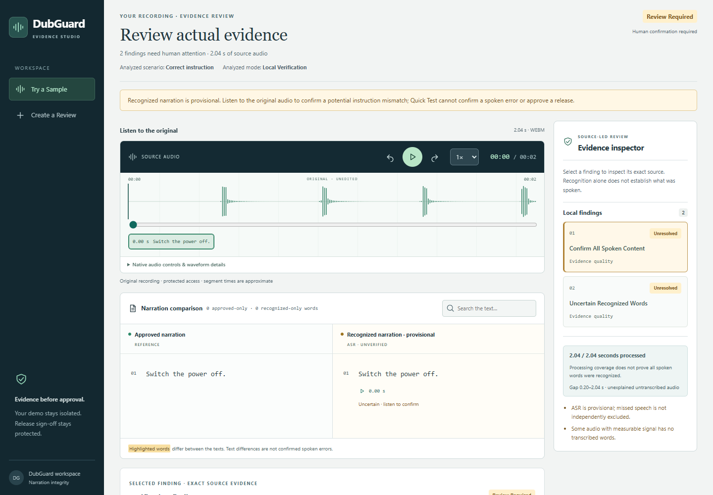
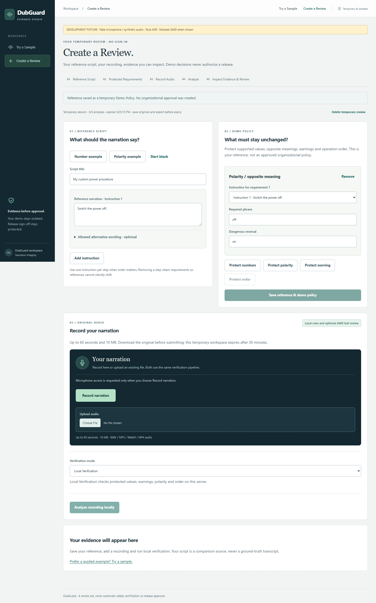

# DubGuard — Industrial Narration Review

DubGuard helps reviewers compare recorded industrial instructions with a reference
script. Small changes such as **off → on**, a changed quantity, an omitted warning,
or reversed procedure order become findings linked to the original evidence.

**DubGuard is a review aid, not safety certification. A `PASS_CANDIDATE` is not
release approval. ASR and model advice cannot establish what was actually spoken.**

[Try a Sample](https://134-209-145-248.sslip.io/test) ·
[Create a Review](https://134-209-145-248.sslip.io/workspace) ·
[GitHub](https://github.com/Eshuredd/DubGuard)

The public installation is hosted on DigitalOcean. Its deployed revision is not
recorded in this checkout; do not assume the latest source is already deployed.

## Public workflows

- **Try a Sample:** choose one of six scenarios, record or upload narration,
  preview/download the original, analyze, and inspect source-linked findings.
- **Create a Review:** write a reference, define protected number, polarity,
  warning and sequence requirements, then analyze your recording. Listen before
  correcting provisional words; save temporary notes, demo decisions and exports.
- **Verification mode:** Local Verification runs deterministic rules on the
  server. Optional AMD Semantic Review requires fresh, unchecked consent for
  each analysis, with no login or access code. Both sets of findings stay visible.

Public sessions expire after 30 minutes and allow three analyses, including at
most two AMD attempts. Recordings are limited to 60 seconds and 10 MB. Anonymous
demo decisions never create authenticated organizational approval.





These local browser captures use synthetic audio and stub recognition; any AMD
responses shown by the test suite are mocked. They illustrate the UI, not accuracy.

## How it works

```text
Reference script + protected requirements       Original recording
                  |                                    |
                  |                         FFmpeg + local CPU Whisper
                  +-------- deterministic checks + provisional transcript
                                             |
                              optional AMD semantic advice
                              + exact source citation validation
                                             |
                             human listening + versioned evidence
                                             |
                             protected review and explicit sign-off
```

**AMD Token Factory / DeepSeek-V4-Flash** receives only reference, requirement and
provisional transcript text. Original audio is not sent to DeepSeek. The provider
key stays on the backend. Returned requirement IDs, instruction/segment IDs and
exact quoted spans are validated locally; unsupported citations require review.
AMD advice cannot erase deterministic violations or approve a recording.

Public AMD is disabled by default until the operator configures the provider and
enables it. Persistent SQLite quotas default to **10 attempts/hour, 40/day and
4/client/day**, shared across both workflows. Failed attempts count. Public calls
use zero retries, one concurrent request, bounded input/output and an emergency
disable switch. See [configuration and operations](DEPLOYMENT.md#public-amd-inference).

Private reviewers enter through `/operator/login` or `/operator`. Separate
authentication protects policy approval, original audio, evidence revisions,
audit history and sign-off. Critical or unresolved evidence blocks approval.
Private entry links are intentionally absent from public navigation.

The stack is React, TypeScript and Vite; Python, FastAPI and Pydantic; FFmpeg,
faster-whisper/CTranslate2 on CPU; SQLite; Docker Compose and Caddy HTTPS.

## Run locally

Use Python 3.11+ and Node.js 22.22.2+ (22.x), 24.15+ (24.x), or 26+.
From the repository root in Bash:

```bash
python3 -m venv .venv
.venv/bin/python -m pip install -r requirements-dev.txt -e .
npm --prefix frontend ci
.venv/bin/python -m dubguard verify examples/critical.json
```

On Windows, create the environment with `py -3.12 -m venv .venv` and use
`.venv/Scripts/python` instead of `.venv/bin/python`. Deterministic CLI verification
needs no model or API key; read the JSON decision rather than treating exit 0 as approval.

For audio, install the optional dependencies and explicitly cache the pinned
Whisper model. This downloads public weights and makes no AMD request:

```bash
.venv/bin/python -m pip install -r requirements-audio.txt
.venv/bin/python deploy/cache_model.py --revision 0d3d19a32d3338f10357c0889762bd8d64bbdeba --output .dubguard-data/models/tiny.en
```

Copy `.env.example` to a private, ignored `.env`. Set `DUBGUARD_WHISPER_MODEL` to
the cached model's absolute directory and `DUBGUARD_DATA_DIR` to a private writable
directory. For local Uvicorn, export these variables into its environment; the
provider/CLI dotenv loader is not general server configuration. Add reviewer or
AMD credentials only for those optional workflows. Never put secrets in Vite
variables, browser storage, URLs, screenshots or Git.

Start the backend and frontend in separate terminals:

```bash
.venv/bin/python -m uvicorn dubguard.api:app --host 127.0.0.1 --port 8000
npm --prefix frontend run dev
```

Open [local Quick Test](http://127.0.0.1:5173/test) or
[local Create a Review](http://127.0.0.1:5173/workspace). Vite proxies `/api` to
FastAPI. Recording needs HTTPS or localhost; missing models are never downloaded
automatically. See [deployment](DEPLOYMENT.md) for Docker, secrets, backups and rollback.

## Results and limitations

The [60-case synthetic development evaluation](docs/EVALUATION.md) reports
22/24 critical recall (91.67%), 22/22 critical-alert precision and zero
acceptable-to-critical alerts on 24 acceptable examples. Two critical semantic
challenges escalate to review and count as recall misses. This is not held-out
industrial ground truth.

One [historical live AMD text smoke](reports/phase4/amd_smoke.json) returned two
valid off/on source spans in 16.393 seconds using 805 tokens. Its
[offline inspection](reports/phase4/amd_smoke_inspection.json) preserved the local
critical decision. Earlier rejected citations and a timeout are also retained.
One example does not establish general semantic or speech accuracy.

Browser tests use synthetic audio, stub ASR and mocked AMD. Historical CPU/container
smokes used real Whisper on silence. Original demo recordings and local results are
preserved privately, but independent human adjudication, speech-accuracy metrics,
physical Safari capture and realistic load testing remain incomplete. English,
single-speaker input and a limited numeric/language grammar are supported. Run one
API process: SQLite history and in-process jobs suit a bounded demonstration.
No ROCm, Quark or AMD Developer Cloud execution is claimed.

## Guides and evidence

- [Architecture and trust boundaries](docs/ARCHITECTURE.md)
- [Evaluation methodology, evidence and regression commands](docs/EVALUATION.md)
- [Deployment, configuration, backups and recovery](DEPLOYMENT.md)
- [Real-audio collection and testing](docs/RECORDING_GUIDE.md)
- [Hackathon submission material](docs/SUBMISSION.md) and [demo reproduction](demo/README.txt)
